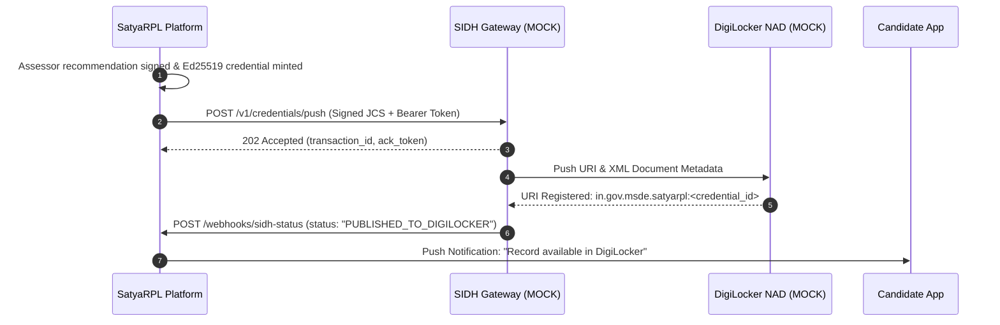

# Proposed Integration Contract: Skill India Digital Hub (SIDH) & DigiLocker
**Status:** MOCK CONTRACT PROPOSAL ONLY (Not connected to live government production endpoints)  
**Version:** 1.0.0-draft  
**Date:** October 11, 2026  

---

## 1. Transparency & Mock Contract Disclosure

> [!IMPORTANT]
> **LEGAL & ARCHITECTURAL DISCLOSURE**  
> This specification represents a proposed technical integration architecture for the **Skill India Digital Hub (SIDH)** and **DigiLocker National Academy Depository (NAD)**.  
> **NO LIVE INTEGRATION CURRENTLY EXISTS.**  
> All endpoints under `/api/mock/sidh/*` are local sandbox mock implementations designed to demonstrate schema compatibility, authentication handshakes, and webhook lifecycles. They carry visible `MOCK CONTRACT` headers and disclaimers.

---

## 2. Architecture Overview



---

## 3. Authentication & Security

1. **Mutual TLS (mTLS):** Required for all enterprise server-to-server traffic between SatyaRPL edge servers and the SIDH gateway.
2. **OAuth2 Client Credentials Grant:**
   * **Token Endpoint:** `POST https://auth.skillindiadigital.gov.in/oauth2/token` (Mock: `/api/mock/sidh/oauth/token`)
   * **Scopes:** `credentials:write`, `credentials:verify`, `webhooks:receive`
   * **Signing Algorithm:** Asymmetric RSA-SHA256 (RS256) or EdDSA.
3. **Payload Signature Integrity:**
   * Every credential payload pushed to SIDH MUST be signed with the platform's active Ed25519 private key.
   * SIDH verifies the signature against SatyaRPL's published `/.well-known/jwks.json`.

---

## 4. API Endpoints

### A. Push Credential to SIDH
* **Endpoint:** `POST /api/mock/sidh/credentials/push`
* **Headers:**
  * `Authorization: Bearer <access_token>`
  * `Content-Type: application/json`
  * `x-mock-notice: "MOCK CONTRACT - Simulated SIDH Server"`
* **Request Schema:**
```json
{
  "clientTransactionId": "tx_2026_001_satyarpl",
  "credentialId": "urn:uuid:c1111111-1111-1111-1111-111111111111",
  "candidateAadhaarVaultRef": "vault_ref_8928392",
  "qualificationCode": "CON/Q0602",
  "nqrCode": "QG-03-CO-03951-2025-V2-CSDCI",
  "verifiablePayload": { ... },
  "signature": "6b7c...ed25519_hex",
  "keyId": "ed25519-key-2026-v1"
}
```
* **Response (202 Accepted):**
```json
{
  "status": "ACCEPTED",
  "sidhTrackingId": "sidh_track_9948291",
  "queuedAt": "2026-10-11T06:00:00Z",
  "mockNotice": "Simulated acceptance in mock sandbox environment."
}
```

### B. Public Verification via SIDH Gateway
* **Endpoint:** `GET /api/mock/sidh/credentials/verify?urn=...`
* **Response (200 OK):**
```json
{
  "verified": true,
  "status": "VALID",
  "digiLockerUri": "in.gov.msde.satyarpl:c1111111-1111-1111-1111-111111111111",
  "qualification": {
    "title": "Assistant Electrician",
    "qpCode": "CON/Q0602",
    "nsqfLevel": 3
  },
  "mockNotice": "Simulated verification against mock DigiLocker directory."
}
```

### C. Webhook Status Callback
* **Endpoint:** `POST /api/mock/sidh/webhook`
* **Triggered When:** Credential is published to candidate's DigiLocker account or when a revocation is synchronized nationally.
* **Payload:**
```json
{
  "eventId": "evt_sidh_status_9921",
  "credentialId": "urn:uuid:c1111111-1111-1111-1111-111111111111",
  "eventType": "DIGILOCKER_ISSUED",
  "timestamp": "2026-10-11T06:05:00Z",
  "digiLockerDocId": "DOC-MSDE-2026-000491",
  "hmacSignature": "a93f..."
}
```

---

## 5. Requirements for Official Production Accreditation

To transition this mock contract into a live national integration, the awarding platform requires:
1. **Accredited Awarding Body Status:** Formal recognition by the **National Council for Vocational Education and Training (NCVET)** as an Awarding Body (AB) or Assessment Agency (AA).
2. **GovDC / NIC Network Peering:** Direct VPN connectivity to National Informatics Centre (NIC) DigiLocker infrastructure.
3. **Aadhaar Vault Compliance:** Integration with a licensed UIDAI Authentication User Agency (AUA/KUA) with hardware security module (HSM) key isolation.
